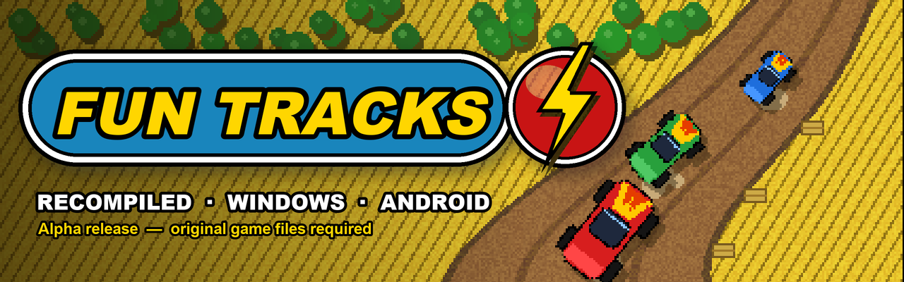
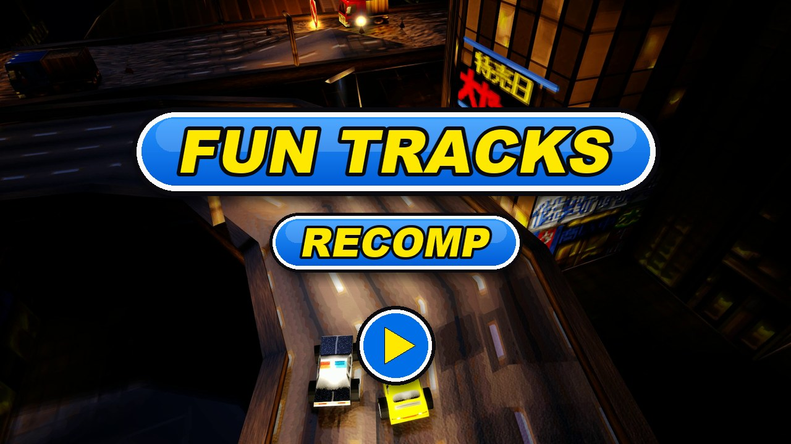

  

  <a href="README.md"> English</a>
  /
  <a href="doc/README.de.md"> Deutsch</a>
  /
  <a href="doc/README.it.md"> Italiano</a>
  /
  <a href="doc/README.es.md"> Español</a>
  /
  <a href="doc/README.sv.md"> Svenska</a>
  /
  <a href="doc/README.fr.md"> Français</a>

# Fun Tracks — recompiled

Fun Tracks (1997) is a top-down racing game with small toy cars on dirt tracks, cornfields and
canyons. This project rebuilds the original Windows game from its decompiled C code, so it runs
natively on today's systems.

This repository only hosts the **releases** (Windows 64-bit and Android). Current version:
**alpha** — expect bugs.

## How this recompilation was made

1. **Decompilation.** The original executable (`FUN_WIN.EXE`, built in 1997 with Microsoft
   Visual C++ 4.2) was turned back into readable C, routine by routine. Each routine is compiled
   again with the same 1996 compiler and compared with the original machine code: same control
   flow and same behaviour, and most of them byte for byte. Progress of that work:
   [decompilation tracker](https://karlos-fr.github.io/fun-tracks-decomp-progress/).
2. **Recompilation.** That C code was then moved to a modern project, built with today's
   compilers in 64-bit. The game itself (races, cars, AI, menus) is the decompiled code; only
   what talked to Windows 95 was replaced: DirectDraw, DirectSound and DirectInput gave way to
   SDL3, and a new GPU renderer draws the 3D picture.
3. **Checks.** A test harness plays scripted games with a fixed clock and keyboard and records
   every frame (picture, race times, car positions). The same games are replayed on the original
   executable to compare, and every change must keep these recordings identical.
4. **AI, openly.** This work was done with AI coding agents: **OpenAI Codex** and **Anthropic
   Claude** (Claude Code). They read the assembly, write and test the C code and the tools; a
   human leads the project, plays, tests and decides. Nothing is accepted on trust: each step is
   checked by the comparisons above.

## Major additions

Compared with the original 1997 game:

- **GPU 3D renderer** (Direct3D 12 on Windows, Vulkan on Android), next to the original software
  renderer; F11 switches between them.
- **Widescreen** in 3D: races fill 16:9 and 21:9 screens, the HUD moves to the screen edges.
- **Live menu demo**: behind the menus, a real race driven by the game's AI and filmed with
  changing camera shots, instead of the recorded video.
- **Six languages** built into the game (English, German, Italian, Spanish, Swedish, French),
  chosen from the system language or in the options.
- **Android** version for handheld consoles, with gamepad controls.
- **Same-screen multiplayer** in 3D for up to six players (keyboard halves and gamepads): views
  split and merge with the race, each player picks a car and sets up their own controls.
- **Graphics enhancements** in 3D, all optional: smooth textures, mipmaps, anisotropic
  filtering, sharpening, anti-aliasing, texture packs, rain, storm and snow (also on the
  camera lens), dynamic lighting and shadows, and a real night with headlights.
- **Network game** for 2 to 6 players, PC or Android console, one per machine: on the local
  network (games are found automatically) or over the Internet (the host opens UDP port 17970).
- **3dfx edition look** (OPTIONS → 3DFX): the effects, redrawn scenery, rain, shadows and 16-bit
  colours of the 1997 3dfx edition, one by one or all at once.
- **Sky, puddles and splashes** in 3D: a real sky (clouds, sunset, stars), puddles under added
  rain that reflect it and ripple when cars drive through, and water splashes from the wheels.
- **Texture packs** (3D renderer): put a pack in the `packs` folder of the game and choose it in the
  graphics options (TEXTURES line). A pack replaces the textures of the cars, scenery and effects and
  the race HUD, at any resolution; whatever it lacks stays original. No pack is included.
- **Round wheels** (option): the cars' wheels become round and roll with the car.
- **Light, moon and reflections** in 3D: light that follows the height of the sun, two-level
  shadows, a moon with its phases, car paint and windows that reflect the sky, seas and rivers
  that behave like water, and a headlights key.
- **Windows**: the window opens at once while the 3D renderer gets ready, and the game checks for
  a new version at launch, shows its notes and installs it in one click (can be turned off).
- **Smooth frame rate** in 3D: 60, 120 or 144 images per second, or the screen's rate (FRAME
  RATE), while the race keeps the 36 steps per second of 1997 and adds no input delay.
- **Modern controller**: progressive stick and triggers, every action can be remapped in the
  player settings.
- **Linux**: a test build for handhelds with PortMaster.
- **CD music** played from OGG files.
- **Same physics everywhere**: races compute exactly the same on every platform.

Full list, version by version:
[CHANGELOG.md](CHANGELOG.md).

## You need the original game

**No file from the original game is included here.**

You must own a copy of the original PC game. Supported editions and installations:

| Edition | Languages | Supported sources | Checked |
|---|---|---|---|
| **Fun Tracks** (CD) | French | installed folder, CD image | yes |
| **Ignition** (CD Europe, Europe re-release, USA re-release) | English, Spanish, Italian, Swedish | installed folder, CD image | yes |
| **Bleifuss Fun** (CD) | German | installed folder, CD image | yes |
| **Ignition** on **GOG** | English, Spanish, Italian, Swedish | the game folder installed by GOG (DOS version, CD in `game.gog`) | yes |
| **Ignition** on **Steam** | English, Spanish, Italian, Swedish | the game folder installed by Steam (same as GOG) | not yet on a real installation |
| Any edition, DOS version only | — | installed DOS folder, with or without the CD image | yes (GOG files) |

Put the recomp in a folder that contains one of: an installed copy of the game (folders `LEVELS`,
`CARS`...), the game folder installed by GOG or Steam (the one with `game.gog`), or an image of
the game CD (a `.cue` file with its `.bin`, or an `.iso`).

To find the full game, start from its page on
[Abandonware France](https://www.abandonware-france.org/ltf_abandon/ltf_jeu.php?id=1172&fic=liens).

Optional: the CD music is played from files named `Music/track02.ogg`, `Music/track03.ogg`...
(OGG, or WAV 16-bit) in the game folder, as in the GOG and Steam folders, or from the audio tracks
of the CD image (`.cue` with its `.bin`).

## Install — Windows 64-bit

Requirements: Windows 10 or 11 (64-bit), a graphics card with DirectX 12.

1. Download `FunTracks-…-windows-x64.zip` from the [Releases](../../releases) page.
2. Extract all the files of the zip (`FunTracks.exe`, `fun_tracks_recomp.ini`, `dxcompiler.dll`,
   `dxil.dll`) into your Fun Tracks game folder.
3. Run `FunTracks.exe`.

Keyboard as in the original game. Alt+Enter: fullscreen / window. F11: 3D renderer / original
renderer.

## Install — Android

Requirements: Android 10 or later, 64-bit ARM device. Made for handheld consoles with buttons
(tested on the AYN Odin 2 Portal); a gamepad is needed.

1. Download `FunTracks-…-android-arm64.apk` from the [Releases](../../releases) page and install
   it (allow installing apps from unknown sources).
2. Start the game once, then close it: this creates its data folder.
3. Connect the device to a PC with a USB cable and copy **the content** of your Fun Tracks game
   folder into `Android/data/com.karlos.funtracks/files/` on the device
   (or: `adb push <game folder>/. /sdcard/Android/data/com.karlos.funtracks/files/`).
4. Start the game.

To use the 3D renderer, also copy `fun_tracks_recomp.ini` (from the Windows zip) into that folder.

Gamepad: stick / d-pad to steer and move in menus, A to accelerate or confirm, B to brake or go
back, X turbo, LB / RB gears, Y rear view, d-pad up headlights, Start pause. Buttons can be changed in the game's key
settings page.
In races, the right trigger accelerates and the left trigger brakes, progressively.

## Install — Linux ARM64 (PortMaster, test build)

Requirements: a 64-bit ARM Linux handheld with PortMaster (Knulli, muOS, ROCKNIX, ArkOS/dArkOS,
AmberELEC…). **Test build**: not yet tested on real devices, please report in [issue
9](https://github.com/Karlos-fr/fun-tracks-recomp-releases/issues/9).

1. Download `FunTracks-…-linux-arm64-portmaster.zip` from the [Releases](../../releases) page
   (until the next release: [`funtracks.zip`](testing/linux-portmaster/funtracks.zip)) and extract
   it into the ports folder of your system (usually `roms/ports/`): you get `Fun Tracks.sh` and
   `funtracks/`.
2. Copy **the content** of your game folder (any supported edition, or the CD image) into
   `ports/funtracks/gamedata/`.
3. Refresh the game list (or restart the system), then start **Fun Tracks** from the Ports
   section.

The port starts with the original 2D renderer; the 3D renderer needs Vulkan and Wayland on the
device. Gamepad as on Android; Select + Start quits. Messages are written to
`ports/funtracks/log.txt`. More details: [testing/linux-portmaster](testing/linux-portmaster).

## Known limitations (alpha)

- Network game tested between a PC and an Android console on a local network; not yet between
  two PCs nor over the Internet.
- Same-screen multiplayer not yet tested on Android.
- Puddles, splashes, atmosphere and reflections not yet tested with a gamepad on an Android
  console.
- The automatic update starts with 0.7.0: install it by hand over an older version.
- Frame rates above 60 not yet measured on 120 and 144 Hz screens; the Linux build is a test
  version.
