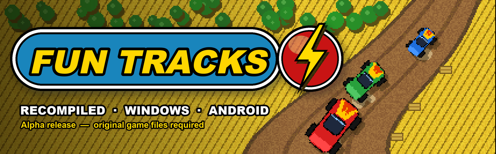

  

  <a href="README.md"> English</a>
  /
  <a href="doc/README.de.md"> Deutsch</a>
  /
  <a href="doc/README.it.md"> Italiano</a>
  /
  <a href="doc/README.es.md"> Español</a>
  /
  <a href="doc/README.sv.md"> Svenska</a>
  /
  <a href="doc/README.fr.md"> Français</a>

  

# Fun Tracks — recompiled

Fun Tracks (1997) is a top-down racing game with small toy cars on dirt tracks, cornfields and
canyons. This project rebuilds the original Windows game from its decompiled C code, so it runs
natively on today's systems.

This repository only hosts the **releases** (Windows 64-bit and Android). Current version:
**alpha** — expect bugs.

## How this recompilation was made

1. **Decompilation.** The original executable (`FUN_WIN.EXE`, built in 1997 with Microsoft
   Visual C++ 4.2) was turned back into readable C, routine by routine. Each routine is compiled
   again with the same 1996 compiler and compared with the original machine code: same control
   flow and same behaviour, and most of them byte for byte. Progress of that work:
   [decompilation tracker](https://karlos-fr.github.io/fun-tracks-decomp-progress/).
2. **Recompilation.** That C code was then moved to a modern project, built with today's
   compilers in 64-bit. The game itself (races, cars, AI, menus) is the decompiled code; only
   what talked to Windows 95 was replaced: DirectDraw, DirectSound and DirectInput gave way to
   SDL3, and a new GPU renderer draws the 3D picture.
3. **Checks.** A test harness plays scripted games with a fixed clock and keyboard and records
   every frame (picture, race times, car positions). The same games are replayed on the original
   executable to compare, and every change must keep these recordings identical.
4. **AI, openly.** This work was done with AI coding agents: **OpenAI Codex** and **Anthropic
   Claude** (Claude Code). They read the assembly, write and test the C code and the tools; a
   human leads the project, plays, tests and decides. Nothing is accepted on trust: each step is
   checked by the comparisons above.

## Major additions

Compared with the original 1997 game:

- **GPU 3D renderer** (Direct3D 12 on Windows, Vulkan on Android), next to the original software
  renderer; F11 switches between them.
- **Widescreen** in 3D: races fill 16:9 and 21:9 screens, the HUD moves to the screen edges.
- **Live menu demo**: behind the menus, a real race driven by the game's AI and filmed with
  changing camera shots, instead of the recorded video.
- **Six languages** built into the game (English, German, Italian, Spanish, Swedish, French),
  chosen from the system language or in the options.
- **Android** version for handheld consoles, with gamepad controls.
- **CD music** played from OGG files.
- **Same physics everywhere**: races compute exactly the same on every platform.

Some of these arrive with the next alpha. Full list, version by version:
[CHANGELOG.md](CHANGELOG.md).

## You need the original game

**No file from the original game is included here.** You must own a copy of the original PC
game (Fun Tracks, 1997) and use the files of its installation folder (the folder that contains
`fun_win.btz`, `LEVELS`, `CARS`...).

To find the full game, start from its page on
[Abandonware France](https://www.abandonware-france.org/ltf_abandon/ltf_jeu.php?id=1172&fic=liens).

Optional: the CD music can be played from OGG files named `Music/track02.ogg`,
`Music/track03.ogg`... in the game folder (ripped from your CD).

## Install — Windows 64-bit

Requirements: Windows 10 or 11 (64-bit), a graphics card with DirectX 12.

1. Download `FunTracks-…-windows-x64.zip` from the [Releases](../../releases) page.
2. Extract `FunTracks.exe` and `fun_tracks_recomp.ini` into your Fun Tracks game folder.
3. Run `FunTracks.exe`.

Keyboard as in the original game. Alt+Enter: fullscreen / window. F11: 3D renderer / original
renderer.

## Install — Android

Requirements: Android 10 or later, 64-bit ARM device. Made for handheld consoles with buttons
(tested on the AYN Odin 2 Portal); a gamepad is needed.

1. Download `FunTracks-…-android-arm64.apk` from the [Releases](../../releases) page and install
   it (allow installing apps from unknown sources).
2. Start the game once, then close it: this creates its data folder.
3. Connect the device to a PC with a USB cable and copy **the content** of your Fun Tracks game
   folder into `Android/data/com.karlos.funtracks/files/` on the device
   (or: `adb push <game folder>/. /sdcard/Android/data/com.karlos.funtracks/files/`).
4. Start the game.

To use the 3D renderer, also copy `fun_tracks_recomp.ini` (from the Windows zip) into that folder.

Gamepad: stick / d-pad to steer and move in menus, A to accelerate or confirm, B to brake or go
back, X turbo, LB / RB gears, Y rear view, Start pause. Buttons can be changed in the game's key
settings page.

## Known limitations (alpha)

- 4:3 picture only (black borders on wide screens); widescreen comes with the next alpha.
- No network multiplayer.
- Only one player on Android.
