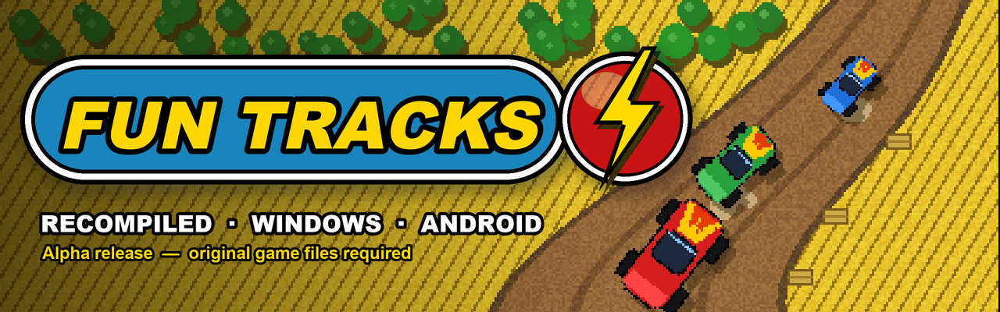
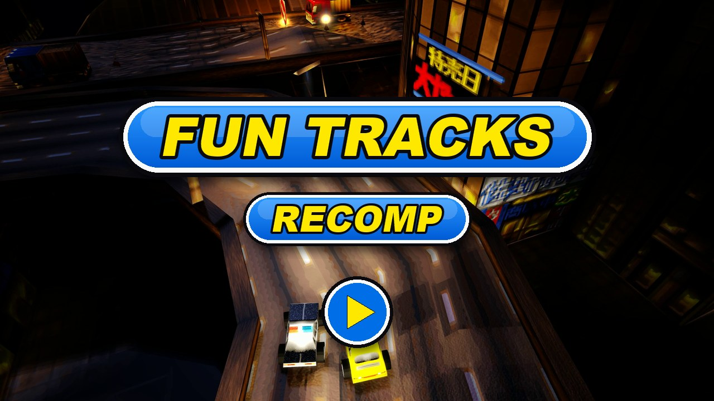

  

  <a href="../README.md"> English</a>
  /
  <a href="README.de.md"> Deutsch</a>
  /
  <a href="README.it.md"> Italiano</a>
  /
  <a href="README.es.md"> Español</a>
  /
  <a href="README.sv.md"> Svenska</a>
  /
  <a href="README.fr.md"> Français</a>

# Fun Tracks — recompilado

Fun Tracks (1997) es un juego de carreras con vista cenital, con pequeños coches de juguete en
pistas de tierra, campos de maíz y cañones. Este proyecto reconstruye el juego original de
Windows a partir de su código C descompilado, para que funcione de forma nativa en los sistemas
actuales.

Este repositorio solo aloja las **versiones publicadas** (Windows de 64 bits y Android). Versión
actual: **alfa**; habrá errores.

## Cómo se hizo esta recompilación

1. **Descompilación.** El ejecutable original (`FUN_WIN.EXE`, compilado en 1997 con Microsoft
   Visual C++ 4.2) se volvió a convertir en C legible, rutina por rutina. Cada rutina se compila
   de nuevo con el mismo compilador de 1996 y se compara con el código máquina original: el
   mismo flujo, el mismo comportamiento y, en la mayoría de los casos, byte a byte. Progreso de
   este trabajo:
   [seguimiento de la descompilación](https://karlos-fr.github.io/fun-tracks-decomp-progress/).
2. **Recompilación.** Después, ese código C se llevó a un proyecto moderno, compilado con los
   compiladores actuales en 64 bits. El juego en sí (carreras, coches, IA, menús) es el código
   descompilado; solo se sustituyó lo que hablaba con Windows 95: DirectDraw, DirectSound y
   DirectInput dieron paso a SDL3, y un nuevo motor de GPU dibuja la imagen en 3D.
3. **Comprobaciones.** Un banco de pruebas juega partidas guionizadas con reloj y teclado fijos y
   registra cada fotograma (imagen, tiempos de carrera, posición de los coches). Las mismas
   partidas se vuelven a jugar en el ejecutable original para comparar, y cada cambio debe dejar
   esos registros idénticos.
4. **IA, sin ocultarlo.** Este trabajo se hizo con agentes de programación con IA: **OpenAI
   Codex** y **Anthropic Claude** (Claude Code). Leen el ensamblador, escriben y prueban el código
   C y las herramientas; una persona dirige el proyecto, juega, prueba y decide. Nada se acepta a
   ciegas: cada paso se verifica con las comparaciones anteriores.

## Novedades principales

Respecto al juego original de 1997:

- **Motor 3D por GPU** (Direct3D 12 en Windows, Vulkan en Android), junto al motor por software
  original; F11 cambia entre ambos.
- **Pantalla panorámica** en 3D: las carreras llenan pantallas 16:9 y 21:9, y la interfaz de
  carrera pasa a los bordes de la pantalla.
- **Demo en vivo en los menús**: detrás de los menús, una carrera real conducida por la IA del
  juego y filmada con planos de cámara cambiantes, en lugar del vídeo grabado.
- **Seis idiomas** integrados en el juego (inglés, alemán, italiano, español, sueco, francés),
  elegidos según el idioma del sistema o en las opciones.
- **Versión para Android** para consolas portátiles, con mando.
- **Multijugador en la misma pantalla** en 3D para hasta seis jugadores (mitades del teclado y
  mandos): las vistas se dividen y se unen según la carrera, cada uno elige su coche y configura
  sus controles.
- **Mejoras gráficas** en 3D, todas opcionales: texturas suavizadas, mipmaps, filtrado
  anisótropo, nitidez, antialiasing, paquetes de texturas HD, lluvia, tormenta y nieve
  (también en el objetivo de la cámara), luz y sombras dinámicas y una noche real con faros.
- **Juego en red** de 2 a 6 jugadores, PC o consola Android, uno por equipo: en la red local (las
  partidas se encuentran solas) o por Internet (el anfitrión abre el puerto UDP 17970).
- **Aspecto de la edición 3dfx** (OPCIONES → 3DFX): efectos, decorados redibujados, lluvia, sombras
  y colores de 16 bits de la edición 3dfx de 1997, uno a uno o todos a la vez.
- **Cielo, charcos y salpicaduras** en 3D: un cielo de verdad (nubes, puesta de sol,
  estrellas), charcos bajo la lluvia añadida que lo reflejan y se rizan al pasar los coches, y
  salpicaduras de agua bajo las ruedas.
- **Texturas HD sin descarga**: creadas en el primer arranque a partir de tus archivos del juego.
- **Ruedas redondas** (opción): las ruedas de los coches se vuelven redondas y giran al rodar.
- **Luz, luna y reflejos** en 3D: una luz que sigue la altura del sol, sombras en dos niveles,
  una luna con sus fases, carrocerías y ventanillas que reflejan el cielo, mares y ríos que se
  comportan como agua, y una tecla para los faros.
- **Windows**: la ventana se abre enseguida mientras se prepara el motor 3D, y el juego busca una
  versión nueva al arrancar, muestra sus notas y la instala con un clic (desactivable).
- **Imagen fluida** en 3D: 60, 120 o 144 imágenes por segundo, o la frecuencia de la pantalla
  (IMAGENES/SEG), mientras la carrera mantiene los 36 pasos por segundo de 1997, sin retraso en
  los controles.
- **Mando moderno**: stick y gatillos progresivos, cada acción se puede reasignar en los ajustes
  de los jugadores.
- **Linux**: una versión de prueba para consolas portátiles con PortMaster.
- **Música del CD** reproducida desde archivos OGG.
- **La misma física en todas partes**: las carreras calculan exactamente lo mismo en cada
  plataforma.

Lista completa, versión por versión:
[CHANGELOG.md](../CHANGELOG.md) (en inglés).

## Se necesita el juego original

**Aquí no se incluye ningún archivo del juego original.**

Hay que tener una copia del juego de PC original. Ediciones e instalaciones compatibles:

| Edición | Idiomas | Orígenes compatibles | Comprobada |
|---|---|---|---|
| **Fun Tracks** (CD) | francés | carpeta instalada, imagen del CD | sí |
| **Ignition** (CD Europa, reedición Europa, reedición EE. UU.) | inglés, español, italiano, sueco | carpeta instalada, imagen del CD | sí |
| **Bleifuss Fun** (CD) | alemán | carpeta instalada, imagen del CD | sí |
| **Ignition** en **GOG** | inglés, español, italiano, sueco | la carpeta del juego instalada por GOG (versión DOS, CD en `game.gog`) | sí |
| **Ignition** en **Steam** | inglés, español, italiano, sueco | la carpeta del juego instalada por Steam (como GOG) | aún no en una instalación real |
| Cualquier edición, solo versión DOS | — | carpeta DOS instalada, con o sin la imagen del CD | sí (archivos de GOG) |

Pon la recomp en una carpeta que contenga una de estas opciones: el juego instalado (carpetas
`LEVELS`, `CARS`...), la carpeta del juego instalada por GOG o Steam (la que tiene `game.gog`), o
una imagen del CD del juego (un archivo `.cue` con su `.bin`, o un `.iso`).

Para encontrar el juego completo, empieza por su página en
[Abandonware France](https://www.abandonware-france.org/ltf_abandon/ltf_jeu.php?id=1172&fic=liens).

Opcional: la música del CD se reproduce desde archivos llamados `Music/track02.ogg`,
`Music/track03.ogg`... (OGG, o WAV de 16 bits) en la carpeta del juego, como en las carpetas de
GOG y Steam, o desde las pistas de audio de la imagen del CD (`.cue` con su `.bin`).

## Instalación — Windows de 64 bits

Requisitos: Windows 10 u 11 (64 bits), una tarjeta gráfica con DirectX 12.

1. Descarga `FunTracks-…-windows-x64.zip` desde la página
   [Releases](https://github.com/Karlos-fr/fun-tracks-recomp-releases/releases).
2. Extrae todos los archivos del zip (`FunTracks.exe`, `fun_tracks_recomp.ini`, `dxcompiler.dll`,
   `dxil.dll`) en la carpeta de tu juego Fun Tracks.
3. Ejecuta `FunTracks.exe`.

Teclado como en el juego original. Alt+Intro: pantalla completa / ventana. F11: motor 3D / motor
original.

## Instalación — Android

Requisitos: Android 10 o posterior, dispositivo ARM de 64 bits. Pensado para consolas portátiles
con botones (probado en la AYN Odin 2 Portal); hace falta un mando.

1. Descarga `FunTracks-…-android-arm64.apk` desde la página
   [Releases](https://github.com/Karlos-fr/fun-tracks-recomp-releases/releases) e instálalo
   (permite instalar aplicaciones de orígenes desconocidos).
2. Abre el juego una vez y ciérralo: así se crea su carpeta de datos.
3. Conecta el dispositivo a un PC con un cable USB y copia **el contenido** de la carpeta de tu
   juego Fun Tracks en `Android/data/com.karlos.funtracks/files/` en el dispositivo
   (o: `adb push <carpeta del juego>/. /sdcard/Android/data/com.karlos.funtracks/files/`).
4. Abre el juego.

Para usar el motor 3D, copia también `fun_tracks_recomp.ini` (del zip de Windows) en esa carpeta.

Mando: stick / cruceta para girar y moverse por los menús, A para acelerar o confirmar, B para
frenar o volver, X turbo, LB / RB marchas, Y vista trasera, cruceta arriba faros, Start pausa. Los botones se cambian
en la página de controles del juego.
En carrera, el gatillo derecho acelera y el izquierdo frena, de forma progresiva.

## Instalación — Linux ARM64 (PortMaster, versión de prueba)

Requisitos: una consola portátil Linux ARM de 64 bits con PortMaster (Knulli, muOS, ROCKNIX,
ArkOS/dArkOS, AmberELEC…). **Versión de prueba**: aún no probada en dispositivos reales, informa
en la [issue 9](https://github.com/Karlos-fr/fun-tracks-recomp-releases/issues/9).

1. Descarga `FunTracks-…-linux-arm64-portmaster.zip` de la página
   [Releases](https://github.com/Karlos-fr/fun-tracks-recomp-releases/releases) (hasta la próxima
   release: [`funtracks.zip`](../testing/linux-portmaster/funtracks.zip)) y extráelo en la carpeta
   de ports del sistema (normalmente `roms/ports/`): obtendrás `Fun Tracks.sh` y `funtracks/`.
2. Copia **el contenido** de la carpeta del juego (cualquier edición compatible, o la imagen del
   CD) en `ports/funtracks/gamedata/`.
3. Actualiza la lista de juegos (o reinicia el sistema) y lanza **Fun Tracks** desde la sección
   Ports.

El port arranca con el renderizador 2D original; el renderizador 3D necesita Vulkan y Wayland en
el dispositivo. Mando como en Android; Select + Start sale. Los mensajes se escriben en
`ports/funtracks/log.txt`. Más detalles: [testing/linux-portmaster](../testing/linux-portmaster).

## Limitaciones conocidas (alfa)

- Juego en red probado entre un PC y una consola Android en una red local; aún no entre dos PC
  ni por Internet.
- Multijugador en la misma pantalla aún no probado en Android.
- Charcos, salpicaduras, atmósfera y reflejos aún no probados con mando en una consola
  Android.
- La actualización automática empieza con la 0.7.0: instalarla a mano sobre una versión
  anterior.
- Las frecuencias por encima de 60 imágenes por segundo aún no se han medido en pantallas de 120 y
  144 Hz; la versión para Linux es una versión de prueba.
