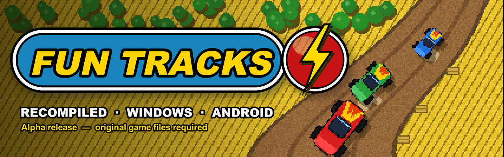
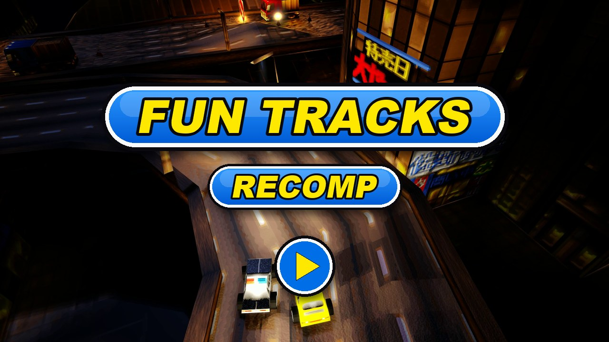

  

  <a href="../README.md"> English</a>
  /
  <a href="README.de.md"> Deutsch</a>
  /
  <a href="README.it.md"> Italiano</a>
  /
  <a href="README.es.md"> Español</a>
  /
  <a href="README.sv.md"> Svenska</a>
  /
  <a href="README.fr.md"> Français</a>

# Fun Tracks — recompilé

Fun Tracks (1997) est un jeu de course vu de dessus, avec de petites voitures jouets sur des
pistes de terre, dans les champs de maïs et les canyons. Ce projet reconstruit le jeu Windows
d'origine à partir de son code C décompilé, pour qu'il tourne nativement sur les systèmes
actuels.

Ce dépôt héberge seulement les **versions publiées** (Windows 64 bits et Android). Version
actuelle : **alpha** — des bugs sont à prévoir.

## Comment cette recompilation a été faite

1. **Décompilation.** L'exécutable d'origine (`FUN_WIN.EXE`, compilé en 1997 avec Microsoft
   Visual C++ 4.2) a été retraduit en C lisible, routine par routine. Chaque routine est
   recompilée avec le même compilateur de 1996 et comparée au code machine d'origine : même
   enchaînement, même comportement, et pour la plupart octet pour octet. Avancement de ce
   travail : [suivi de la décompilation](https://karlos-fr.github.io/fun-tracks-decomp-progress/).
2. **Recompilation.** Ce code C a ensuite été repris dans un projet moderne, compilé avec les
   compilateurs actuels en 64 bits. Le jeu lui-même (courses, voitures, IA, menus) est le code
   décompilé ; seul ce qui parlait à Windows 95 a été remplacé : DirectDraw, DirectSound et
   DirectInput ont laissé place à SDL3, et un nouveau moteur GPU dessine l'image en 3D.
3. **Vérifications.** Un harnais de test joue des parties scriptées avec une horloge et un
   clavier fixes, et enregistre chaque image (image, temps de course, position des voitures).
   Les mêmes parties sont rejouées sur l'exécutable d'origine pour comparer, et chaque
   changement doit laisser ces enregistrements identiques.
4. **L'IA, assumée.** Ce travail a été fait avec des agents de programmation IA : **OpenAI
   Codex** et **Anthropic Claude** (Claude Code). Ils lisent l'assembleur, écrivent et testent le
   code C et les outils ; un humain mène le projet, joue, teste et décide. Rien n'est accepté
   sur parole : chaque étape est vérifiée par les comparaisons ci-dessus.

## Principaux ajouts

Par rapport au jeu d'origine de 1997 :

- **Moteur 3D GPU** (Direct3D 12 sous Windows, Vulkan sous Android), à côté du moteur logiciel
  d'origine ; F11 passe de l'un à l'autre.
- **Écran large** en 3D : les courses remplissent les écrans 16:9 et 21:9, l'interface de course
  va sur les bords de l'écran.
- **Démo live dans les menus** : derrière les menus, une vraie course pilotée par l'IA du jeu et
  filmée avec des plans de caméra variés, à la place de la vidéo enregistrée.
- **Six langues** intégrées au jeu (anglais, allemand, italien, espagnol, suédois, français),
  choisies d'après la langue du système ou dans les options.
- **Version Android** pour les consoles portables, jouable à la manette.
- **Multijoueur sur le même écran** en 3D jusqu'à six joueurs (moitiés du clavier et manettes) :
  les vues se partagent et se rejoignent selon la course, chacun choisit sa voiture et règle ses
  commandes.
- **Améliorations graphiques** en 3D, toutes au choix : textures lissées, mipmaps, filtrage
  anisotrope, netteté, anticrénelage, packs de textures, pluie, orage et neige (aussi sur
  l'objectif de la caméra), éclairage et ombres dynamiques, et une vraie nuit avec phares.
- **Jeu en réseau** de 2 à 6 joueurs, PC ou console Android, un par poste : sur le réseau local
  (les parties se trouvent toutes seules) ou par Internet (l'hôte ouvre le port UDP 17970).
- **Rendu de l'édition 3dfx** (OPTIONS → 3DFX) : effets, décor redessiné, pluie, ombres et couleurs
  16 bits de l'édition 3dfx de 1997, un par un ou tous à la fois.
- **Ciel, flaques et éclaboussures** en 3D : un vrai ciel (nuages, coucher de soleil, étoiles),
  des flaques sous la pluie ajoutée qui le reflètent et se rident au passage des voitures, et
  des gerbes d'eau sous les roues.
- **Packs de textures** (moteur 3D) : un pack se pose dans le dossier `packs` du jeu et se choisit
  dans les options graphiques (ligne TEXTURES). Il remplace les textures des voitures, du décor et des
  effets, l'interface de la course, les menus et les écrans de chargement, à n'importe quelle résolution ; ce qu'il ne contient pas reste
  d'origine. Aucun pack n'est fourni.
- **Roues rondes** (option) : les roues des voitures deviennent rondes et tournent en roulant.
- **Lumière, lune et reflets** en 3D : une lumière qui suit la hauteur du soleil, des ombres
  sur deux niveaux, une lune et ses phases, des carrosseries et des vitres qui reflètent le ciel,
  des mers et des rivières qui se comportent comme de l'eau, et une touche pour les phares.
- **Windows** : la fenêtre s'ouvre tout de suite pendant que le moteur 3D se prépare, et le jeu
  cherche une nouvelle version au lancement, montre ses notes et l'installe en un clic
  (désactivable).
- **Images fluides** en 3D : 60, 120 ou 144 images par seconde, ou le rythme de l'écran
  (IMAGES/SECONDE), la course gardant les 36 pas par seconde de 1997, sans retard des commandes.
- **Manette moderne** : stick et gâchettes progressifs, chaque action se règle dans les réglages
  des joueurs.
- **Linux** : une version d'essai pour les consoles portables avec PortMaster.
- **Musique du CD** jouée depuis des fichiers OGG.
- **La même physique partout** : les courses donnent exactement les mêmes calculs sur toutes les
  plateformes.

Liste complète, version par version :
[CHANGELOG.md](../CHANGELOG.md) (en anglais).

## Il faut le jeu original

**Aucun fichier du jeu original n'est fourni ici.**

Il faut posséder une copie du jeu PC d'origine. Éditions et installations prises en charge :

| Édition | Langues | Sources prises en charge | Vérifiée |
|---|---|---|---|
| **Fun Tracks** (CD) | français | dossier installé, image du CD | oui |
| **Ignition** (CD Europe, réédition Europe, réédition USA) | anglais, espagnol, italien, suédois | dossier installé, image du CD | oui |
| **Bleifuss Fun** (CD) | allemand | dossier installé, image du CD | oui |
| **Ignition** chez **GOG** | anglais, espagnol, italien, suédois | le dossier du jeu installé par GOG (version DOS, CD dans `game.gog`) | oui |
| **Ignition** chez **Steam** | anglais, espagnol, italien, suédois | le dossier du jeu installé par Steam (comme GOG) | pas encore sur une vraie installation |
| Toute édition, version DOS seule | — | dossier DOS installé, avec ou sans l'image du CD | oui (fichiers GOG) |

Placez la recomp dans un dossier qui contient au choix : le jeu installé (dossiers `LEVELS`,
`CARS`...), le dossier du jeu installé par GOG ou Steam (celui qui contient `game.gog`), ou une
image du CD du jeu (un fichier `.cue` et son `.bin`, ou un `.iso`).

Pour trouver le jeu complet, partez de sa page sur
[Abandonware France](https://www.abandonware-france.org/ltf_abandon/ltf_jeu.php?id=1172&fic=liens).

Facultatif : la musique du CD est jouée depuis des fichiers nommés `Music/track02.ogg`,
`Music/track03.ogg`... (OGG, ou WAV 16 bits) dans le dossier du jeu, comme dans les dossiers GOG
et Steam, ou depuis les pistes audio de l'image du CD (`.cue` et son `.bin`).

## Installation — Windows 64 bits

Configuration : Windows 10 ou 11 (64 bits), une carte graphique compatible DirectX 12.

1. Téléchargez `FunTracks-…-windows-x64.zip` depuis la page
   [Releases](https://github.com/Karlos-fr/fun-tracks-recomp-releases/releases).
2. Extrayez tous les fichiers du zip (`FunTracks.exe`, `fun_tracks_recomp.ini`, `dxcompiler.dll`,
   `dxil.dll`) dans le dossier de votre jeu Fun Tracks.
3. Lancez `FunTracks.exe`.

Clavier comme dans le jeu d'origine. Alt+Entrée : plein écran / fenêtre. F11 : moteur 3D /
moteur d'origine.

## Installation — Android

Configuration : Android 10 ou plus récent, appareil ARM 64 bits. Pensé pour les consoles
portables à boutons (testé sur l'AYN Odin 2 Portal) ; une manette est nécessaire.

1. Téléchargez `FunTracks-…-android-arm64.apk` depuis la page
   [Releases](https://github.com/Karlos-fr/fun-tracks-recomp-releases/releases) et installez-le
   (autorisez l'installation d'applications de sources inconnues).
2. Lancez le jeu une fois, puis fermez-le : cela crée son dossier de données.
3. Branchez l'appareil à un PC par câble USB et copiez **le contenu** du dossier de votre jeu
   Fun Tracks dans `Android/data/com.karlos.funtracks/files/` sur l'appareil
   (ou : `adb push <dossier du jeu>/. /sdcard/Android/data/com.karlos.funtracks/files/`).
4. Lancez le jeu.

Pour utiliser le moteur 3D, copiez aussi `fun_tracks_recomp.ini` (depuis le zip Windows) dans ce
dossier.

Manette : stick / croix pour diriger et se déplacer dans les menus, A pour accélérer ou valider,
B pour freiner ou revenir, X turbo, LB / RB vitesses, Y vue arrière, croix haut phares, Start pause. Les boutons se
changent dans la page des touches du jeu.
En course, la gâchette droite accélère et la gauche freine, progressivement.

## Installation — Linux ARM64 (PortMaster, version d'essai)

Configuration : une console portable Linux ARM 64 bits avec PortMaster (Knulli, muOS, ROCKNIX,
ArkOS/dArkOS, AmberELEC…). **Version d'essai** : pas encore essayée sur de vraies consoles, merci
de rendre compte dans l'[issue
9](https://github.com/Karlos-fr/fun-tracks-recomp-releases/issues/9).

1. Téléchargez `FunTracks-…-linux-arm64-portmaster.zip` sur la page
   [Releases](https://github.com/Karlos-fr/fun-tracks-recomp-releases/releases) (d'ici la
   prochaine release : [`funtracks.zip`](../testing/linux-portmaster/funtracks.zip)) et
   extrayez-le dans le dossier des ports de votre système (en général `roms/ports/`) : vous
   obtenez `Fun Tracks.sh` et `funtracks/`.
2. Copiez **le contenu** de votre dossier du jeu (n'importe quelle édition prise en charge, ou
   l'image du CD) dans `ports/funtracks/gamedata/`.
3. Actualisez la liste des jeux (ou redémarrez le système), puis lancez **Fun Tracks** dans la
   section Ports.

Le port démarre avec le rendu 2D d'origine ; le rendu 3D demande Vulkan et Wayland sur la console.
Manette comme sur Android ; Select + Start quitte. Les messages sont écrits dans
`ports/funtracks/log.txt`. Plus de détails :
[testing/linux-portmaster](../testing/linux-portmaster).

## Limites connues (alpha)

- Jeu en réseau essayé entre un PC et une console Android sur un réseau local ; pas encore entre
  deux PC ni par Internet.
- Multijoueur sur le même écran pas encore essayé sur Android.
- Flaques, éclaboussures, atmosphère et reflets pas encore essayés à la manette sur une
  console Android.
- La mise à jour automatique commence avec la 0.7.0 : l'installer à la main par-dessus une
  version plus ancienne.
- Les rythmes au-delà de 60 images par seconde ne sont pas encore mesurés sur des écrans 120 et
  144 Hz ; la version Linux est une version d'essai.
