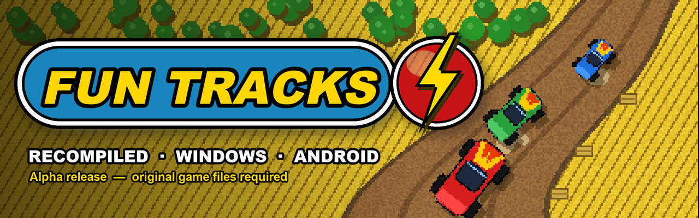
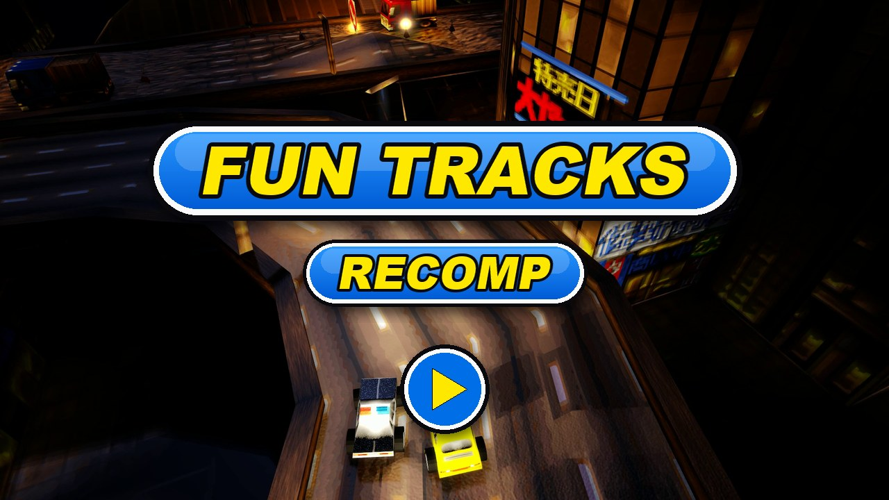

  

  <a href="../README.md"> English</a>
  /
  <a href="README.de.md"> Deutsch</a>
  /
  <a href="README.it.md"> Italiano</a>
  /
  <a href="README.es.md"> Español</a>
  /
  <a href="README.sv.md"> Svenska</a>
  /
  <a href="README.fr.md"> Français</a>

# Fun Tracks — ricompilato

Fun Tracks (1997) è un gioco di corse con visuale dall'alto, con piccole auto giocattolo su
piste sterrate, campi di mais e canyon. Questo progetto ricostruisce il gioco Windows originale a
partire dal suo codice C decompilato, così che funzioni in modo nativo sui sistemi di oggi.

Questo repository contiene solo le **versioni pubblicate** (Windows 64 bit, Android e Linux). Versione
attuale: **alpha** — aspettatevi dei bug.

## Come è stata fatta questa ricompilazione

1. **Decompilazione.** L'eseguibile originale (`FUN_WIN.EXE`, compilato nel 1997 con Microsoft
   Visual C++ 4.2) è stato riportato in C leggibile, routine per routine. Ogni routine viene
   ricompilata con lo stesso compilatore del 1996 e confrontata con il codice macchina originale:
   stesso flusso, stesso comportamento e, per la maggior parte, byte per byte. Avanzamento di
   questo lavoro:
   [monitoraggio della decompilazione](https://karlos-fr.github.io/fun-tracks-decomp-progress/).
2. **Ricompilazione.** Questo codice C è stato poi portato in un progetto moderno, compilato con
   i compilatori di oggi a 64 bit. Il gioco vero e proprio (gare, auto, IA, menu) è il codice
   decompilato; è stato sostituito solo ciò che parlava con Windows 95: DirectDraw, DirectSound e
   DirectInput hanno lasciato il posto a SDL3, e un nuovo renderer GPU disegna l'immagine in 3D.
3. **Verifiche.** Un sistema di test gioca partite predefinite con orologio e tastiera fissi e
   registra ogni fotogramma (immagine, tempi di gara, posizione delle auto). Le stesse partite
   vengono rigiocate sull'eseguibile originale per il confronto, e ogni modifica deve lasciare
   queste registrazioni identiche.
4. **L'IA, dichiarata.** Questo lavoro è stato fatto con agenti di programmazione IA: **OpenAI
   Codex** e **Anthropic Claude** (Claude Code). Leggono l'assembly, scrivono e testano il codice
   C e gli strumenti; una persona guida il progetto, gioca, prova e decide. Nulla viene accettato
   sulla fiducia: ogni passo è verificato dai confronti qui sopra.

## Principali novità

Rispetto al gioco originale del 1997:

- **Renderer 3D su GPU** (Direct3D 12 su Windows, Vulkan su Android), accanto al renderer
  software originale; F11 passa dall'uno all'altro.
- **Schermo panoramico** in 3D: le gare riempiono gli schermi 16:9 e 21:9, l'interfaccia di gara
  si sposta ai bordi dello schermo.
- **Demo dal vivo nei menu**: dietro i menu, una vera gara guidata dall'IA del gioco e ripresa
  con inquadrature che cambiano, al posto del video registrato.
- **Sei lingue** integrate nel gioco (inglese, tedesco, italiano, spagnolo, svedese, francese),
  scelte in base alla lingua del sistema o nelle opzioni.
- **Versione Android** per console portatili, con controlli da gamepad.
- **Multigiocatore sullo stesso schermo** in 3D fino a sei giocatori (metà della tastiera e
  gamepad): le visuali si dividono e si riuniscono secondo la gara, ognuno sceglie la sua auto e
  configura i suoi comandi.
- **Miglioramenti grafici** in 3D, tutti facoltativi: texture levigate, mipmap, filtro
  anisotropo, nitidezza, antialiasing, pacchetti di texture, pioggia, temporale e neve
  (anche sull'obiettivo), luci e ombre dinamiche e una vera notte con i fari.
- **Gioco in rete** da 2 a 6 giocatori, PC o console Android, uno per dispositivo: in rete locale
  (le partite si trovano da sole) o via Internet (l'host apre la porta UDP 17970).
- **Aspetto dell'edizione 3dfx** (OPZIONI → 3DFX): effetti, scenari ridisegnati, pioggia, ombre e
  colori a 16 bit dell'edizione 3dfx del 1997, uno per uno o tutti insieme.
- **Cielo, pozzanghere e schizzi** in 3D: un vero cielo (nuvole, tramonto, stelle), pozzanghere
  sotto la pioggia aggiunta che lo riflettono e si increspano al passaggio delle auto, e
  schizzi d'acqua sotto le ruote.
- **Pacchetti di texture** (motore 3D): un pacchetto va nella cartella `packs` del gioco e si
  sceglie nelle opzioni grafiche (riga TEXTURE). Sostituisce le texture delle auto, del paesaggio e
  degli effetti, l'interfaccia di gara, i menu e le schermate di caricamento, a qualsiasi risoluzione; ciò che manca resta originale.
  Un **pacchetto HD** è proposto a parte (`FunTracks-hd-pack-….zip`, parziale: interfaccia, auto e
  primo circuito); per farne uno: [Making a texture pack](https://github.com/Karlos-fr/fun-tracks-recomp-releases/wiki/Making-a-texture-pack) (bozza, in inglese).
- **Ruote rotonde** (opzione): le ruote delle auto diventano rotonde e girano mentre l'auto
  corre.
- **Luce, luna e riflessi** in 3D: una luce che segue l'altezza del sole, ombre su due livelli,
  una luna con le sue fasi, carrozzerie e finestrini che riflettono il cielo, mari e fiumi che si
  comportano come acqua, e un tasto per i fari.
- **Windows**: la finestra si apre subito mentre il motore 3D si prepara, e il gioco cerca una
  nuova versione all'avvio, ne mostra le note e la installa con un clic (disattivabile).
- **Fotogrammi fluidi** in 3D: 60, 120 o 144 fotogrammi al secondo, o la frequenza dello schermo
  (FOTOGRAMMI/SEC), mentre la gara mantiene i 36 passi al secondo del 1997, senza ritardo dei
  comandi.
- **Controller moderno**: levetta e grilletti progressivi, ogni azione riassegnabile nelle
  impostazioni dei giocatori.
- **Linux**: versioni di prova per PC (x86_64) e per console portatili con PortMaster.
- **Menu più grandi** (DIMENSIONE MENU): 1,25 o 1,5 volte più grandi, più leggibili su schermi
  grandi.
- **Sospensioni** in 3D (SOSPENSIONI): la carrozzeria si inclina in curva, si abbassa in frenata
  e si alza in accelerazione.
- **Musica del CD** riprodotta da file OGG.
- **La stessa fisica ovunque**: le gare danno esattamente gli stessi calcoli su ogni piattaforma.

Elenco completo, versione per versione:
[CHANGELOG.md](../CHANGELOG.md) (in inglese).

## Serve il gioco originale

**Qui non è incluso alcun file del gioco originale.**

Bisogna possedere una copia del gioco PC originale. Edizioni e installazioni supportate:

| Edizione | Lingue | Origini supportate | Verificata |
|---|---|---|---|
| **Fun Tracks** (CD) | francese | cartella installata, immagine del CD | sì |
| **Ignition** (CD Europa, ristampa Europa, ristampa USA) | inglese, spagnolo, italiano, svedese | cartella installata, immagine del CD | sì |
| **Bleifuss Fun** (CD) | tedesco | cartella installata, immagine del CD | sì |
| **Ignition** su **GOG** | inglese, spagnolo, italiano, svedese | la cartella del gioco installata da GOG (versione DOS, CD in `game.gog`) | sì |
| **Ignition** su **Steam** | inglese, spagnolo, italiano, svedese | la cartella del gioco installata da Steam (come GOG) | non ancora su una vera installazione |
| Qualsiasi edizione, solo versione DOS | — | cartella DOS installata, con o senza immagine del CD | sì (file GOG) |

Mettete la recomp in una cartella che contenga a scelta: il gioco installato (cartelle `LEVELS`,
`CARS`...), la cartella del gioco installata da GOG o Steam (quella con `game.gog`), o un'immagine
del CD del gioco (un file `.cue` con il suo `.bin`, o un `.iso`).

Per trovare il gioco completo, partite dalla sua pagina su
[Abandonware France](https://www.abandonware-france.org/ltf_abandon/ltf_jeu.php?id=1172&fic=liens).

Facoltativo: la musica del CD viene riprodotta da file chiamati `Music/track02.ogg`,
`Music/track03.ogg`... (OGG, o WAV a 16 bit) nella cartella del gioco, come nelle cartelle di GOG
e Steam, o dalle tracce audio dell'immagine del CD (`.cue` con il suo `.bin`).

## Installazione — Windows 64 bit

Requisiti: Windows 10 o 11 (64 bit), una scheda grafica con DirectX 12.

1. Scaricate `FunTracks-…-windows-x64.zip` dalla pagina
   [Releases](https://github.com/Karlos-fr/fun-tracks-recomp-releases/releases).
2. Estraete tutti i file dello zip (`FunTracks.exe`, `fun_tracks_recomp.ini`, `dxcompiler.dll`,
   `dxil.dll`) nella cartella del gioco Fun Tracks.
3. Avviate `FunTracks.exe`.

Tastiera come nel gioco originale. Alt+Invio: schermo intero / finestra. F11: renderer 3D /
renderer originale.

## Installazione — Android

Requisiti: Android 10 o successivo, dispositivo ARM a 64 bit. Pensato per console portatili con
tasti (provato sull'AYN Odin 2 Portal); serve un gamepad.

1. Scaricate `FunTracks-…-android-arm64.apk` dalla pagina
   [Releases](https://github.com/Karlos-fr/fun-tracks-recomp-releases/releases) e installatelo
   (consentite l'installazione di app da origini sconosciute).
2. Avviate il gioco una volta, poi chiudetelo: così viene creata la sua cartella dati.
3. Collegate il dispositivo a un PC con un cavo USB e copiate **il contenuto** della cartella del
   gioco Fun Tracks in `Android/data/com.karlos.funtracks/files/` sul dispositivo
   (oppure: `adb push <cartella del gioco>/. /sdcard/Android/data/com.karlos.funtracks/files/`).
4. Avviate il gioco.

Per usare il renderer 3D, copiate anche `fun_tracks_recomp.ini` (dallo zip per Windows) in quella
cartella.

Gamepad: levetta / croce direzionale per sterzare e muoversi nei menu, A per accelerare o
confermare, B per frenare o tornare indietro, X turbo, LB / RB marce, Y vista posteriore, croce
su fari, Start pausa. I tasti si cambiano nella pagina dei comandi del gioco.
In gara il grilletto destro accelera e quello sinistro frena, in modo progressivo.

## Installazione — Linux x86_64 (PC, versione di prova)

Requisiti: un PC Linux a 64 bit con glibc 2.35 o più recente (Ubuntu 22.04, Debian 12, Fedora 36
o successivi); un driver Vulkan per il renderer 3D. **Versione di prova**: finora provata solo
sotto WSL, fateci sapere come funziona.

1. Scaricate `FunTracks-…-linux-x64.tar.gz` dalla pagina
   [Releases](https://github.com/Karlos-fr/fun-tracks-recomp-releases/releases).
2. Estraetelo nella cartella del gioco Fun Tracks (o accanto all'immagine del CD):
   `tar -xzf FunTracks-…-linux-x64.tar.gz -C <cartella del gioco>`.
3. Avviate `FunTracks.sh`.

Senza driver Vulkan, il gioco torna da solo al renderer 2D originale.

## Installazione — Linux ARM64 (PortMaster, versione di prova)

Requisiti: una console portatile Linux ARM a 64 bit con PortMaster (Knulli, muOS, ROCKNIX,
ArkOS/dArkOS, AmberELEC…). **Versione di prova**: non ancora provata su dispositivi reali,
segnalate nell'[issue 9](https://github.com/Karlos-fr/fun-tracks-recomp-releases/issues/9).

1. Scaricate `FunTracks-…-linux-arm64-portmaster.zip` dalla pagina
   [Releases](https://github.com/Karlos-fr/fun-tracks-recomp-releases/releases) ed estraetelo
   nella cartella dei port del sistema (di solito `roms/ports/`): otterrete `Fun Tracks.sh` e
   `funtracks/`.
2. Copiate **il contenuto** della cartella del gioco (qualsiasi edizione supportata, o l'immagine
   del CD) in `ports/funtracks/gamedata/`.
3. Aggiornate l'elenco dei giochi (o riavviate il sistema), poi avviate **Fun Tracks** dalla
   sezione Ports.

Il port parte con il renderer 2D originale; il renderer 3D richiede Vulkan e Wayland sul
dispositivo. Gamepad come su Android; Select + Start esce. I messaggi sono scritti in
`ports/funtracks/log.txt`.

## Limiti noti (alpha)

- Gioco in rete provato tra un PC e una console Android in rete locale; non ancora tra due PC né
  via Internet.
- Multigiocatore sullo stesso schermo non ancora provato su Android.
- Pozzanghere, schizzi, atmosfera e riflessi non ancora provati con il gamepad su una console
  Android.
- L'aggiornamento automatico parte dalla 0.7.0: installarla a mano sopra una versione
  precedente.
- Le frequenze oltre 60 fotogrammi al secondo non sono ancora misurate su schermi a 120 e 144 Hz;
  le versioni Linux sono versioni di prova (quella per PC è stata provata solo sotto WSL).
