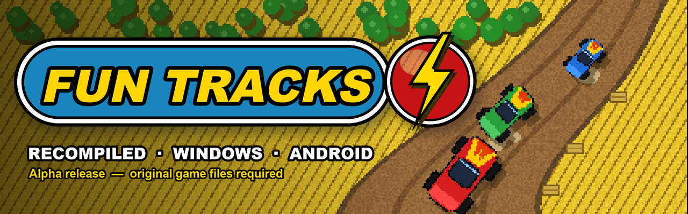
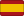
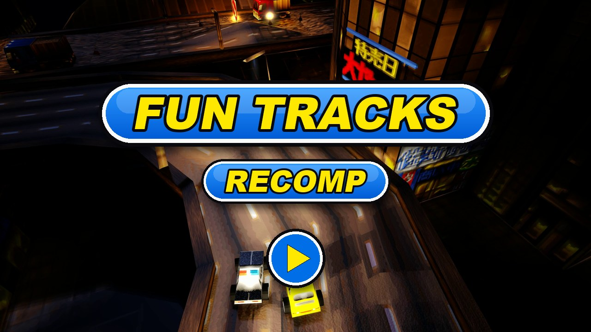

  

  <a href="../README.md"> English</a>
  /
  <a href="README.de.md"> Deutsch</a>
  /
  <a href="README.it.md"> Italiano</a>
  /
  <a href="README.es.md"> Español</a>
  /
  <a href="README.sv.md"> Svenska</a>
  /
  <a href="README.fr.md"> Français</a>

# Fun Tracks — omkompilerat

Fun Tracks (1997) är ett racingspel sett uppifrån, med små leksaksbilar på grusbanor, i
majsfält och kanjoner. Det här projektet bygger upp det ursprungliga Windows-spelet igen från
dess dekompilerade C-kod, så att det körs direkt på dagens system.

Det här repot innehåller bara **utgåvorna** (Windows 64-bitars, Android och Linux). Nuvarande version:
**alfa** — räkna med buggar.

## Så gjordes omkompileringen

1. **Dekompilering.** Den ursprungliga programfilen (`FUN_WIN.EXE`, byggd 1997 med Microsoft
   Visual C++ 4.2) översattes tillbaka till läsbar C, rutin för rutin. Varje rutin kompileras
   igen med samma kompilator från 1996 och jämförs med den ursprungliga maskinkoden: samma
   flöde, samma beteende, och de flesta byte för byte. Arbetets framsteg:
   [dekompileringens framstegssida](https://karlos-fr.github.io/fun-tracks-decomp-progress/).
2. **Omkompilering.** C-koden flyttades sedan till ett modernt projekt, byggt med dagens
   kompilatorer i 64 bitar. Själva spelet (lopp, bilar, AI, menyer) är den dekompilerade koden;
   bara det som pratade med Windows 95 byttes ut: DirectDraw, DirectSound och DirectInput
   ersattes av SDL3, och en ny GPU-renderare ritar 3D-bilden.
3. **Kontroller.** En testmiljö spelar förinspelade partier med fast klocka och tangentbord och
   sparar varje bildruta (bild, lopptider, bilarnas positioner). Samma partier spelas upp på den
   ursprungliga programfilen för jämförelse, och varje ändring måste lämna inspelningarna
   identiska.
4. **AI, öppet redovisat.** Arbetet gjordes med AI-programmeringsagenter: **OpenAI Codex** och
   **Anthropic Claude** (Claude Code). De läser assemblerkoden, skriver och testar C-koden och
   verktygen; en människa leder projektet, spelar, testar och bestämmer. Inget godtas på tro:
   varje steg kontrolleras med jämförelserna ovan.

## Viktigaste tilläggen

Jämfört med originalspelet från 1997:

- **GPU-baserad 3D-renderare** (Direct3D 12 på Windows, Vulkan på Android), bredvid den
  ursprungliga mjukvarurenderaren; F11 växlar mellan dem.
- **Bredbild** i 3D: loppen fyller 16:9- och 21:9-skärmar och loppets visning flyttas till
  skärmens kanter.
- **Livedemo i menyerna**: bakom menyerna körs ett riktigt lopp som styrs av spelets AI och
  filmas med växlande kameravinklar, i stället för den inspelade videon.
- **Sex språk** inbyggda i spelet (engelska, tyska, italienska, spanska, svenska, franska),
  valda efter systemets språk eller i inställningarna.
- **Android-version** för handhållna konsoler, med handkontroll.
- **Flerspelarläge på samma skärm** i 3D för upp till sex spelare (tangentbordshalvor och
  handkontroller): vyerna delas och slås ihop efter loppet, var och en väljer sin bil och ställer
  in sina kontroller.
- **Grafikförbättringar** i 3D, alla valfria: utjämnade texturer, mipmaps, anisotropisk
  filtrering, skärpa, kantutjämning, texturpaket, regn, åska och snö (även på
  kameralinsen), dynamiskt ljus och skuggor samt en riktig natt med strålkastare.
- **Nätverksspel** för 2 till 6 spelare, PC eller Android-konsol, en per enhet: i det lokala
  nätverket (spelen hittas automatiskt) eller över Internet (värden öppnar UDP-port 17970).
- **3dfx-utgåvans utseende** (INSTÄLLNINGAR → 3DFX): effekter, omritad miljö, regn, skuggor och
  16-bitarsfärger från 3dfx-utgåvan från 1997, en i taget eller alla på en gång.
- **Himmel, pölar och stänk** i 3D: en riktig himmel (moln, solnedgång, stjärnor), pölar i
  tillagt regn som speglar den och krusas när bilarna kör igenom, och vattenstänk under hjulen.
- **Texturpaket** (3D-renderaren): ett paket läggs i spelets mapp `packs` och väljs i
  grafikinställningarna (raden TEXTURER). Det ersätter bilarnas, banans och effekternas texturer samt
  racegränssnittet, menyerna och laddningsskärmarna, i vilken upplösning som helst; det som saknas förblir original. Ett
  **HD-paket** finns som separat nedladdning (`FunTracks-hd-pack-….zip`, gränssnitt,
  bilar och alla sju banorna); gör ditt eget: [Making a texture pack](https://github.com/Karlos-fr/fun-tracks-recomp-releases/wiki/Making-a-texture-pack) (utkast, på engelska).
- **Runda hjul** (tillval): bilarnas hjul blir runda och rullar med bilen.
- **Ljus, måne och reflexer** i 3D: ljus som följer solens höjd, skuggor i två nivåer, en måne
  med sina faser, lack och rutor som speglar himlen, hav och floder som beter sig som vatten, och
  en knapp för strålkastarna.
- **Windows**: fönstret öppnas direkt medan 3D-renderaren förbereds, och spelet letar efter en ny
  version vid start, visar dess anteckningar och installerar den med ett klick (kan stängas av).
- **Mjuk bildfrekvens** i 3D: 60, 120 eller 144 bilder per sekund, eller skärmens frekvens
  (BILDER/SEK), medan loppet behåller 1997 års 36 steg per sekund, utan fördröjning i
  kontrollerna.
- **Modern handkontroll**: stegslös spak och avtryckare, varje funktion kan ändras i
  spelarinställningarna.
- **Linux**: testversioner för PC (x86_64) och för handhållna konsoler med PortMaster.
- **Större menyer** (MENYSTORLEK): 1,25 eller 1,5 gånger större, lättare att läsa på stora
  skärmar.
- **Fjädring** i 3D (FJÄDRING): karossen lutar i kurvor, dyker vid inbromsning och lyfter vid
  acceleration.
- **Mjukare landskap** i 3D: MJUKA YTOR (ljus utan facetter), RUNDADE FORMER (rundade kanter)
  och KAMERASKAKNING (kameran skakar när bilen tar en stöt).
- **CD-musik** spelas upp från OGG-filer.
- **Samma fysik överallt**: loppen räknar exakt likadant på alla plattformar.

Fullständig lista, version för version:
[CHANGELOG.md](../CHANGELOG.md) (på engelska).

## Originalspelet behövs

**Ingen fil från originalspelet ingår här.**

Du måste äga en kopia av det ursprungliga PC-spelet. Utgåvor och installationer som stöds:

| Utgåva | Språk | Källor som stöds | Kontrollerad |
|---|---|---|---|
| **Fun Tracks** (cd) | franska | installerad mapp, cd-avbild | ja |
| **Ignition** (cd Europa, nyutgåva Europa, nyutgåva USA) | engelska, spanska, italienska, svenska | installerad mapp, cd-avbild | ja |
| **Bleifuss Fun** (cd) | tyska | installerad mapp, cd-avbild | ja |
| **Ignition** på **GOG** | engelska, spanska, italienska, svenska | spelmappen som GOG installerat (DOS-versionen, cd:n i `game.gog`) | ja |
| **Ignition** på **Steam** | engelska, spanska, italienska, svenska | spelmappen som Steam installerat (som GOG) | inte ännu på en riktig installation |
| Alla utgåvor, endast DOS-versionen | — | installerad DOS-mapp, med eller utan cd-avbilden | ja (GOG-filer) |

Lägg recompen i en mapp som innehåller något av: det installerade spelet (mapparna `LEVELS`,
`CARS`...), spelmappen som GOG eller Steam installerat (den med `game.gog`), eller en avbild av
spelets cd (en `.cue`-fil med sin `.bin`, eller en `.iso`).

För att hitta hela spelet, börja på dess sida hos
[Abandonware France](https://www.abandonware-france.org/ltf_abandon/ltf_jeu.php?id=1172&fic=liens).

Valfritt: cd-musiken spelas upp från filer med namnen `Music/track02.ogg`, `Music/track03.ogg`...
(OGG, eller WAV 16 bitar) i spelmappen, som i mapparna från GOG och Steam, eller från ljudspåren i
cd-avbilden (`.cue` med sin `.bin`).

## Installation — Windows 64-bitars

Krav: Windows 10 eller 11 (64-bitars), ett grafikkort med DirectX 12.

1. Ladda ner `FunTracks-…-windows-x64.zip` från sidan
   [Releases](https://github.com/Karlos-fr/fun-tracks-recomp-releases/releases).
2. Packa upp alla filer i zip-filen (`FunTracks.exe`, `fun_tracks_recomp.ini`, `dxcompiler.dll`,
   `dxil.dll`) i din Fun Tracks-spelmapp.
3. Starta `FunTracks.exe`.

Tangentbord som i originalspelet. Alt+Enter: helskärm / fönster. F11: 3D-renderare /
ursprunglig renderare.

## Installation — Android

Krav: Android 10 eller senare, 64-bitars ARM-enhet. Gjord för handhållna konsoler med knappar
(testad på AYN Odin 2 Portal); en handkontroll behövs.

1. Ladda ner `FunTracks-…-android-arm64.apk` från sidan
   [Releases](https://github.com/Karlos-fr/fun-tracks-recomp-releases/releases) och installera
   den (tillåt installation av appar från okända källor).
2. Starta spelet en gång och stäng det: då skapas dess datamapp.
3. Anslut enheten till en PC med en USB-kabel och kopiera **innehållet** i din Fun Tracks-spelmapp
   till `Android/data/com.karlos.funtracks/files/` på enheten
   (eller: `adb push <spelmapp>/. /sdcard/Android/data/com.karlos.funtracks/files/`).
4. Starta spelet.

För att använda 3D-renderaren, kopiera också `fun_tracks_recomp.ini` (från Windows-zippen) till
den mappen.

Handkontroll: spak / styrkors för att styra och röra sig i menyerna, A för att gasa eller
bekräfta, B för att bromsa eller gå tillbaka, X turbo, LB / RB växlar, Y backspegel, styrkors upp strålkastare, Start paus.
Knapparna kan ändras på spelets sida för kontroller.
I loppet gasar höger avtryckare och vänster bromsar, stegslöst.

## Installation — Linux x86_64 (PC, testversion)

Krav: en 64-bitars PC med Linux och glibc 2.35 eller nyare (Ubuntu 22.04, Debian 12, Fedora 36
eller senare); en Vulkan-drivrutin för 3D-renderaren. **Testversion**: hittills bara provad i
WSL, berätta gärna hur den fungerar.

1. Ladda ner `FunTracks-…-linux-x64.tar.gz` från sidan
   [Releases](https://github.com/Karlos-fr/fun-tracks-recomp-releases/releases).
2. Packa upp den i Fun Tracks-spelmappen (eller bredvid cd-avbilden):
   `tar -xzf FunTracks-…-linux-x64.tar.gz -C <spelmapp>`.
3. Starta `FunTracks.sh`.

Utan Vulkan-drivrutin går spelet själv tillbaka till den ursprungliga 2D-renderaren.

## Installation — Linux ARM64 (PortMaster, testversion)

Krav: en handhållen Linux-konsol med 64-bitars ARM och PortMaster (Knulli, muOS, ROCKNIX,
ArkOS/dArkOS, AmberELEC…). **Testversion**: ännu inte provad på riktiga enheter, rapportera gärna
i [issue 9](https://github.com/Karlos-fr/fun-tracks-recomp-releases/issues/9).

1. Ladda ner `FunTracks-…-linux-arm64-portmaster.zip` från sidan
   [Releases](https://github.com/Karlos-fr/fun-tracks-recomp-releases/releases) och packa upp den i
   systemets ports-mapp (oftast `roms/ports/`): du får `Fun Tracks.sh` och `funtracks/`.
2. Kopiera **innehållet** i din spelmapp (vilken utgåva som helst som stöds, eller cd-avbilden)
   till `ports/funtracks/gamedata/`.
3. Uppdatera spellistan (eller starta om systemet) och starta **Fun Tracks** under Ports.

Porten startar med den ursprungliga 2D-renderaren; 3D-renderaren kräver Vulkan och Wayland på
enheten. Handkontroll som på Android; Select + Start avslutar. Meddelanden skrivs till
`ports/funtracks/log.txt`.

## Kända begränsningar (alfa)

- Nätverksspel testat mellan en PC och en Android-konsol i ett lokalt nätverk; ännu inte mellan
  två PC eller över Internet.
- Flerspelarläge på samma skärm ännu inte testat på Android.
- Pölar, stänk, atmosfär och reflexer ännu inte testade med handkontroll på en Android-konsol.
- Den automatiska uppdateringen börjar med 0.7.0: installera den för hand över en äldre version.
- Bildfrekvenser över 60 är ännu inte uppmätta på skärmar med 120 och 144 Hz; Linux-versionerna är
  testversioner (PC-versionen har bara provats i WSL).
